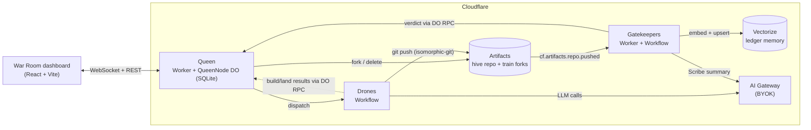

# QueenOS

**An operating system for agent swarms, built on Cloudflare Artifacts. Not a GitHub clone.**

Built for Cloudflare's [next Git platform](https://blog.cloudflare.com/next-git-platform-on-cloudflare/) challenge. MIT licensed. Needs Node 22+ (`.nvmrc` pins 24; wrangler requires 22 or later).

Humans file prompts. A swarm of ephemeral drones turns each into a commit, a pipeline of gatekeepers reviews it, and a scheduler (the Queen) decides what lands on `main` and in what order. The War Room dashboard shows all of it live.

## The three questions

**How do agents know what other agents are working on?**
There is one source of truth: the **Queen**, a SQLite-backed Durable Object per hive. Every prompt, train, drone task and audit event lives there and is broadcast over hibernating WebSockets. Drones never talk to each other; they read and write through the Queen. On top of that sits the **Cognitive Ledger**: each commit carries its agent's reasoning (task prompt, model, reasoning steps, discarded paths) as a git note in `refs/notes/queen` (falling back to `.queen/ledger/<sha>.json` if the notes push is refused). Gatekeepers embed every failure log into **Vectorize** (`queenos-failures`) as the swarm's memory of what went wrong. Feeding it back into drones as RAG context is the next step; `ragContext` is wired through but currently empty.

**What happens when they make conflicting changes?**
The **Speculative Merge Train**. Prompts queue up; train *k* holds `main + prompts 1..k` via chained Artifacts forks. All trains are tested in parallel on the assumption that everything ahead of them passes. When one fails it is ejected, everything that contained it is rebuilt without it, and the failed prompt is sent back for rework. Conflicts surface as a failed train, not a human merge session.

**How do you review everything they produce?**
Three layers. **Gatekeepers** (Policy, Security, tests) run on every push to a train fork and post a verdict. The **Scribe** compacts each verdict into a 500-character summary that the dashboard shows and the rework agent receives. The **per-commit ledger** keeps the full reasoning behind every change, so a reviewer can read what the agent was thinking, not just what it wrote.

## Architecture



Drones and gatekeepers call the Queen over **Durable Object RPC**, not public HTTP.

## Merge train walkthrough

Three agents submit prompts **A**, **B**, **C** in that order. B contains a bug.

1. Queen creates one train per prompt, in queue order, each a chained fork:
   - T1 = `main + A`, forked from the hive repo.
   - T2 = `main + A + B`, forked from T1 once T1's builder has pushed.
   - T3 = `main + A + B + C`, forked from T2 once T2's builder has pushed.
   Builds chain one after another; tests start as soon as each train is pushed and run in parallel.
2. T1 passes. It is at the head of the queue, so a lander drone pushes it to `main` (Artifacts has no merge API) and T1 is MERGED.
3. T2's gatekeepers fail it. **B's train is EJECTED** and its fork deleted. The Scribe's summary says why.
4. T3 contains B, so it is **superseded**: ejected and reprovisioned under a new id as `main + A + C`, forked from the nearest surviving predecessor (T1's result, or `main` once A has landed). **C is rebuilt without B.**
5. B goes back on the queue at the tail as a **rework task** carrying the Scribe summary, so the agent sees what failed. The new train is `main + A + C + B'`.
6. C passes and lands. B' is tested, then lands, or is ejected again. After 2 reworks a prompt is marked FAILED.

Results arrive in any order and webhooks can be retried: duplicate or late results return `ignored:*` instead of corrupting state. The planner is pure (`apps/queen/src/train/planner.ts`) and unit-tested; see [apps/queen/README.md](apps/queen/README.md) for the full phase and route tables.

## Cloudflare primitives

| Primitive | Why |
|---|---|
| **Artifacts** | Git repos as an API. `fork()` gives every train its own cheap copy; repos are deleted when a train is ejected or lands. |
| **Workers** | Hono HTTP surface for the Queen and gatekeepers. No Node built-ins anywhere. |
| **Durable Objects + SQLite + WebSocket hibernation** | One Queen per hive: serialized scheduling (no races between webhooks), durable state, cheap live fan-out to dashboards. Alarms retry failed fork/dispatch intents. |
| **Workflows** | Drones are durable, retryable, multi-step jobs (fork, generate, commit, push). A crashed drone resumes instead of restarting. |
| **Event Subscriptions** | `cf.artifacts.repo.pushed` triggers the gatekeepers Workflow; no polling. |
| **Vectorize** | Semantic memory over the Cognitive Ledger. |
| **AI Gateway (BYOK)** | One place for provider keys, logging, caching and rate limits. Workers send only `cf-aig-authorization`; the provider key stays stored in the gateway. |
| **Workers AI** | Embeddings for the ledger memory. |

## Quickstart (local, no credentials)

Sim mode runs the real Queen Worker and Durable Object with fake Artifacts and auto-advancing fake drones, so the whole merge train plays out on your laptop.

```bash
nvm use                                    # Node 24 (22+ works)
pnpm install
pnpm --filter @queenos/queen dev:sim       # terminal 1: Queen on :8787
pnpm --filter @queenos/dashboard dev       # terminal 2: dashboard on :5173
```

Open <http://localhost:5173/?hive=demo> and click **Launch demo swarm**. The dashboard proxies `/hives` to the Queen at `localhost:8787` (override with `QUEEN_DEV_URL`).

## Tests

```bash
pnpm test                                  # everything, via Turborepo
pnpm turbo run build typecheck lint test   # the full gate
```

| Package | Covers |
|---|---|
| `apps/queen` (workerd via `@cloudflare/vitest-pool-workers`) | Pure planner state machine; the Durable Object end to end with fake Artifacts and drones (fork chaining, ejection, rework, landing, reconcile alarms); WebSocket protocol and hibernation; bearer-token auth on machine routes; sim ports. |
| `apps/drones` (workerd) | Drone workflow orchestration with fake ports and scripted LLM output. |
| `apps/gatekeepers` | Policy, Security and test gatekeepers, Scribe compaction, Vectorize failure memory. Triggered by `cf.artifacts.repo.pushed` via `triggers.events`. |
| `apps/dashboard` (vitest, node) | The War Room reducer: snapshots, train lanes, audit cards, rework attempts. |
| `packages/hive-kit`, `packages/queen-types` | Git on isomorphic-git + in-memory fs, ledger payloads, AI Gateway client, Zod schemas. |

## Full stack locally (no Cloudflare calls)

Runs the edge (dev auth), Genesis (scripted LLM, fake provisioner), the Vault (against a local fake Cloudflare API) and the Queen (sim) together.

One-time setup (both files are gitignored):
- `apps/vault/.dev.vars`: `VAULT_KEK=<openssl rand -base64 32>` and `VAULT_DEV_CF_BASE=http://127.0.0.1:8799`
- `apps/genesis/.dev.vars`: `GENESIS_DEV_FAKE_PROVISIONER=1`

```bash
pnpm --filter @queenos/dashboard build
node scripts/dev/fake-cloudflare.mjs &
(cd apps/vault   && pnpm exec wrangler dev --port 8791 --inspector-port 9291) &
(cd apps/queen   && pnpm exec wrangler dev --env sim --port 8792 --inspector-port 9292) &
sleep 12
(cd apps/genesis && pnpm exec wrangler dev --port 8793 --inspector-port 9293) &
(cd apps/edge    && pnpm exec wrangler dev --env dev --port 8787 --inspector-port 9294) &
```

Open http://localhost:8787. Any 32-hex account id and any fake token work. The edge's `dev` env and the Queen's `sim` env refuse non-localhost requests, so deploying them by mistake can't bypass Access.

## Deploy to Cloudflare

Needs a Workers Paid account (Artifacts) and wrangler 4.145+. Steps marked **(unverified)** have not been run against a real account; [docs/day1-verification.md](docs/day1-verification.md) is the runbook for resolving them.

The public front door is one Worker, `queenos-edge`, at **https://queenos.kaikeru.com**, behind Cloudflare Access. It verifies the Access JWT, serves the dashboard, hosts the project registry, and forwards to `queenos-vault`, `queenos-genesis` and the `queen` over service bindings. The queen has `workers_dev: false`, so it is reachable only through the edge.

### One-time resources

- Vectorize index for failure memory: `wrangler vectorize create queenos-failures --dimensions=768 --metric=cosine` (matches the gatekeepers' binding and the 768-dim `@cf/baai/bge-base-en-v1.5` embeddings).
- AI Gateway named `queenos` (authenticated). Optional: add your Anthropic key under AI Gateway > `queenos` > Provider Keys with alias `default`; without it third-party models fall back to Unified Billing. LLM calls use the Workers AI `AI` binding through the gateway, so there are no tokens. Per-role models are wrangler vars `MODEL_BUILDER` (default `anthropic/claude-opus-5-5`) and `MODEL_SCRIBE` (default `anthropic/claude-haiku-4-5`); `DRONE_LLM_MODE` is `scripted` (deterministic, good for the demo video) or `live`.
- Event subscription: `cf.artifacts.repo.pushed` to the gatekeepers Workflow via `triggers.events` **(unverified: payload shape and filter syntax, see the runbook)**.

### Deploy

```bash
scripts/deploy.sh              # bootstrap pass if needed, then full pass
scripts/deploy.sh --bootstrap  # force the bootstrap pass
scripts/deploy.sh --dry-run    # build every bundle into .deploy-dryrun/, deploy nothing
```

The Workers bind to each other in cycles (queen and the executors, genesis and the provisioner, the edge to everything), and wrangler rejects a binding to a script that does not exist yet (code 10061, `docs/day1-results.md`). The script therefore runs two passes over queen, provisioner, herald, drones, gatekeepers, vault, genesis and edge:

1. **Bootstrap pass** (automatic when any script has never been deployed, or forced with `--bootstrap`): deploy every Worker from a temporary config with its cross-script bindings stripped (DO and Workflow bindings that have `script_name`, and all `services`). Own DOs, Workflows, migrations, assets and routes are kept. The real config files are untouched.
2. **Full pass:** deploy every Worker with its full config.

The provisioner's template generator runs before it deploys, and the dashboard is built before the edge. It deploys with `--env=""` (the `sim`, `dev` and `test` envs are not for deployment) and prints the manual steps below when it finishes. `--only <app>` limits a pass to one app dir (e.g. `--only edge`).

### One-time setup (after the first deploy)

Your Zero Trust team is `kaikeru` (team domain `kaikeru.cloudflareaccess.com`).

1. **Access application.** Zero Trust > Access > Applications > Add > Self-hosted. Domain `queenos.kaikeru.com`, all paths. Add a policy: Action Allow, Include emails ending in `@kaikeru.com`. The edge repeats the domain check on the verified JWT as a second layer.
2. **AUD.** Copy the application's "Application Audience (AUD) Tag" into `ACCESS_AUD` in `apps/edge/wrangler.jsonc` and redeploy the edge (`pnpm --filter @queenos/edge deploy`). While `ACCESS_AUD` is empty the edge fails closed: every route except `/health` returns 503.
3. **Vault key.** Generate and store the key-encryption key on the vault Worker:
   ```bash
   openssl rand -base64 32 | pnpm --filter @queenos/vault exec wrangler secret put VAULT_KEK --env=""
   ```
4. **Queen machine token.** `openssl rand -hex 32 | pnpm --filter @queenos/queen exec wrangler secret put QUEEN_INTERNAL_TOKEN --env=""`. It guards the Queen's machine-only HTTP routes, which return 503 without it.
5. Open https://queenos.kaikeru.com, sign in, and confirm the War Room connects.

Local development: `pnpm --filter @queenos/edge exec wrangler dev --env dev` skips Access verification and acts as `DEV_USER_EMAIL`. Never deploy the `dev` env.

## Repo layout

```
apps/queen         Hono Worker + QueenNode DO: scheduler, state, WebSocket room
apps/drones        Workflow: builder, rework and lander drones (git push to Artifacts)
apps/gatekeepers   Worker + Workflow: Policy / Security / tests gatekeepers, Scribe, Vectorize
apps/dashboard     React + Vite War Room
packages/queen-types   Shared Zod schemas and types
packages/hive-kit      Worker-safe git, AI Gateway client, Cognitive Ledger helpers
docs/discovery.md      Platform research: what is verified vs unverified
```

## Design decisions

- **One Queen per hive, as a Durable Object.** Single-threaded scheduling removes webhook races; every other component is stateless or ephemeral. See [docs/discovery.md](docs/discovery.md) §4.
- **Chained forks, not one fork per prompt off `main`.** Train *k* literally contains prompts 1..k, so a passing train is exactly what will land.
- **Landing is a push.** Artifacts has no merge API, so a lander drone pushes the passed head to `main`.
- **Persisted intents.** Fork, delete and dispatch are written to SQLite before any I/O and re-issued by an alarm if they fail.
- **Pure planner.** Train logic has no I/O, clock or randomness, so it is tested exhaustively and deterministically.
- **Platform unknowns are documented, not assumed.** [docs/discovery.md](docs/discovery.md) cites a source or says UNVERIFIED.

## Known limitations

- **Test execution is scripted**, not a real preview deploy. Gatekeepers run policy and security scans and a scripted test verdict; they do not build and run the pushed code.
- **Git-notes push to Artifacts is unverified.** isomorphic-git writes `refs/notes/queen` and works locally; whether Artifacts accepts the push is unknown. If refused, the ledger falls back to `.queen/ledger/<sha>.json` in the tree.
- **TypeScript policy scanning is heuristic** (AST pattern checks), not a full static analyzer.
- **Webhook auth covers machine routes only.** `POST /prompts`, `GET /snapshot` and the WebSocket room are open. Anyone who can reach the Queen can submit prompts and watch a hive; real user auth is needed beyond the hackathon.
- **Artifacts billing starts 2026-10-14**; fork cost and latency are unmeasured.
- **Sim mode is a simulation.** It exercises the Queen and dashboard for real, but drones and Artifacts are fakes.

## License

[MIT](LICENSE) © 2026 Kyle Wagner
