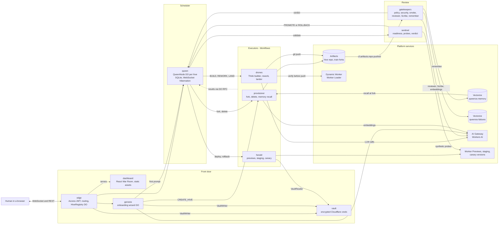

# QueenOS

**An operating system for agent swarms, built on Cloudflare Artifacts. Not a GitHub clone.**

Built for Cloudflare's [next Git platform](https://blog.cloudflare.com/next-git-platform-on-cloudflare/) challenge. MIT licensed. Needs Node 22+ (`.nvmrc` pins 24; wrangler requires 22 or later).

Humans file prompts. A swarm of ephemeral drones turns each into a commit, a pipeline of gatekeepers reviews it, and a scheduler (the Queen) decides what lands on `main` and in what order. The War Room dashboard shows all of it live.

## The three questions

### How do agents know what other agents are working on?

**One Queen per hive, and shared memory.** *Primitives: Durable Objects + SQLite + WebSocket hibernation, Artifacts, Vectorize, Workers AI.*

- **The Queen is the single source of truth.** It is a SQLite-backed Durable Object per hive. Every prompt, train, drone task and audit event is written there first, then broadcast over hibernating WebSockets to the War Room. Drones never talk to each other; they read and write through the Queen. The Queen is an orchestrator only: it decides, records and dispatches, and executors do all external I/O.
- **The Cognitive Ledger.** Each commit carries its agent's reasoning (task prompt, model, reasoning steps, discarded paths) as a git note in `refs/notes/queen`, falling back to `.queen/ledger/<sha>.json` if the notes push is refused.
- **Hive memory.** Every gate verdict (PASSED, FAILED or REJECTED_BY_REVIEW) is embedded with Workers AI (`@cf/baai/bge-base-en-v1.5`) and stored in Vectorize (`queenos-memory`). When the Provisioner forks a new train it recalls up to 5 memories from the same hive (cosine score 0.6 or higher). The Queen stores them on the train and hands them to the builder as `ragContext`, and the War Room lane shows them as recalled-memory cards. The drones are thrown away after each build; what they learned is not. The Queen never touches Vectorize. Failure logs also go to a second index, `queenos-failures`.

### What happens when they make conflicting changes?

**The speculative merge train.** *Primitives: Artifacts forks, Workflows, Durable Objects.*

Prompts queue up; train *k* holds `main + prompts 1..k` via chained Artifacts forks. All trains are tested in parallel on the assumption that everything ahead of them passes. When one fails it is ejected, everything that contained it is rebuilt without it, and the failed prompt goes back to the tail as a rework. A conflict surfaces as a failed train, not a human merge session. The planner is a pure function (`apps/queen/src/train/planner.ts`); see the [walkthrough](#merge-train-walkthrough).

### How do you review everything they produce?

**Four layers, then a human tap.** *Primitives: Event Subscriptions (`cf.artifacts.repo.pushed`), Workflows, Worker Preview URLs and gradual deployments, AI Gateway / Workers AI.*

1. **Gatekeepers.** Every push to a train fork fires `cf.artifacts.repo.pushed`, which starts the gatekeepers Workflow. It runs a **Policy** scan (dependency allowlist, imports) and a **Security** scan (secrets, `eval`, outbound hosts), then a **preview smoke test**: the Herald has already deployed the train to a Worker Preview URL, and the gate requires `GET /` there to answer 2xx. A 500 is a real bug in the pushed code. The `[fail]` test runner is still scripted (`GATE_TEST_MODE=scripted`); it does not run a test suite.
2. **LLM reviewer.** Passing the scans and the smoke test shows the code is safe and alive, not that it did what was asked. The reviewer (a Workers AI model through AI Gateway) reads the prompt, the changed files and what `GET /` on the preview actually served, and judges intent. A rejection becomes the Scribe summary, the train is ejected, and the prompt goes back for a **REWORK** that carries the reviewer's feedback. The verdict is also remembered. If the model is unusable the reviewer fails open rather than blocking the gate.
3. **Scribe.** When a train fails, the Scribe compacts the raw failure log into at most 500 characters. The Queen never sees raw logs; that summary is all it stores, the War Room shows, and the rework builder receives.
4. **Sentinel.** Landing on `main` is not shipping. The Queen cuts a release from everything landed, and the Herald deploys it to `<hive>-staging`. Sentinel first runs a **readiness gate** (consecutive 2xx on `/`), then fires **synthetic probes** pinned to each Worker version, then returns **PROMOTE or ROLLBACK**. It does this at staging and again at each canary step.

After staging passes, the release waits for a **human tap** in the War Room. The Herald then moves traffic between Worker versions at 1, 10, 50 and 100 percent (gradual deployments), with Sentinel checking each step and an automatic rollback on a bad verdict. The per-commit ledger keeps the full reasoning behind every change, so a reviewer can read what the agent was thinking, not just what it wrote.

<!-- screenshots: War Room swarm, memories panel, release timeline -->

## Architecture

Ten components (nine Workers plus the dashboard, which the edge serves as static assets), one Queen Durable Object per hive. Solid arrows are commands or data; every executor reports its result back to the Queen over Durable Object RPC, keyed by command id, so retries and late results are ignored rather than corrupting state.



| Worker | Role |
|---|---|
| `queen` | Scheduler and state: merge-train and release planners, model router, watchdog, WebSocket room. Reachable only through the edge. |
| `queenos-edge` | Front door at `queenos.kaikeru.com`: Access JWT verification, dashboard assets, routing, project registry. |
| dashboard | The React + Vite War Room: lanes, release timeline, tap to ship, recalled memories. Served by the edge. |
| `queenos-provisioner` | Artifacts fork and delete, seeds new hives from `templates/worker-starter`, recalls hive memories on fork. |
| `queenos-drones` | BUILD, REWORK and LAND. The builder is a Think agent (below). |
| `queenos-gatekeepers` | Policy, security, preview smoke, LLM reviewer, Scribe, failure log and hive memory writes. |
| `queenos-herald` | Worker Preview per train, `<hive>-staging`, canary splits on `<hive>-app`, rollback. |
| `queenos-sentinel` | Readiness gate, synthetic probes per version, PROMOTE or ROLLBACK. |
| `queenos-vault` | Per-hive AES-GCM envelope-encrypted Cloudflare credentials. |
| `queenos-genesis` | Onboarding wizard: chat, charter, connect Cloudflare, create hive, first flight. |

## The drone builder

The builder is a [`@cloudflare/think`](https://www.npmjs.com/package/@cloudflare/think) tool-loop agent (`apps/drones/src/agent/`), one Durable Object per build attempt and model. Inside the drone Workflow it works on a workspace seeded from the train's fork with Think's file tools (read, write, edit, list, find, grep, delete), capped at 16 steps. Before it can finish, it must call `verify`: the edited Worker is loaded into a **Dynamic Worker** through the Worker Loader binding, with outbound network blocked, and `GET /`, `/health` and any extra paths are fetched so the agent sees real status codes and bodies. `finish` is refused unless the last `verify` came after the last edit and passed. Only then does the Workflow push to Artifacts, with the tool trace recorded in the commit's ledger note. The Dynamic Worker check proves the routes answer; the Herald preview, the gatekeepers and Sentinel remain the deploy truth. The Queen picks the model per task (the model router) and every call goes through AI Gateway; `DRONE_HARNESS=single-shot` keeps the older single-call JSON builder.


## Merge train walkthrough

Three agents submit prompts **A**, **B**, **C** in that order. B contains a bug.

1. Queen creates one train per prompt, in queue order, each a chained fork:
   - T1 = `main + A`, forked from the hive repo.
   - T2 = `main + A + B`, forked from T1 once T1's builder has pushed.
   - T3 = `main + A + B + C`, forked from T2 once T2's builder has pushed.
   Builds chain one after another; tests start as soon as each train is pushed and run in parallel.
2. T1 passes. It is at the head of the queue, so a lander drone pushes it to `main` (Artifacts has no merge API) and T1 is MERGED.
3. T2's gatekeepers fail it. **B's train is EJECTED** and its fork deleted. The Scribe's summary says why.
4. T3 contains B, so it is **superseded**: ejected and reprovisioned under a new id as `main + A + C`, forked from the nearest surviving predecessor (T1's result, or `main` once A has landed). **C is rebuilt without B.**
5. B goes back on the queue at the tail as a **rework task** carrying the Scribe summary, so the agent sees what failed. The new train is `main + A + C + B'`.
6. C passes and lands. B' is tested, then lands, or is ejected again. After 2 reworks a prompt is marked FAILED.

Results arrive in any order and webhooks can be retried: duplicate or late results return `ignored:*` instead of corrupting state. The planner is pure (`apps/queen/src/train/planner.ts`) and unit-tested; see [apps/queen/README.md](apps/queen/README.md) for the full phase and route tables.

## Cloudflare primitives

| Primitive | Why |
|---|---|
| **Artifacts** | Git repos as an API. `fork()` gives every train its own cheap copy; repos are deleted when a train is ejected or lands. |
| **Workers** | Hono HTTP surface for the edge and the Queen, and one Worker per executor. Service bindings between them; no Node built-ins anywhere. |
| **Durable Objects + SQLite + WebSocket hibernation** | One Queen per hive: serialized scheduling (no races between webhooks), durable state, cheap live fan-out to dashboards. Alarms retry failed fork/dispatch intents. |
| **Workflows** | Provisioner, drones, gatekeepers, Herald and Sentinel are durable, retryable, multi-step jobs. A crashed step resumes instead of restarting. |
| **Event Subscriptions** | `cf.artifacts.repo.pushed` triggers the gatekeepers Workflow; no polling. |
| **Vectorize** | `queenos-memory`: hive memory, one entry per gate verdict, recalled at fork. `queenos-failures`: failure logs. |
| **AI Gateway / Workers AI** | Every LLM call (builder, reviewer, Scribe, Genesis) goes through the Workers `AI` binding and the `queenos` gateway for logging, caching and rate limits; models are Workers AI `@cf/...` models. Embeddings use `@cf/baai/bge-base-en-v1.5`. |
| **Worker Preview URLs and gradual deployments** | Each train gets a Preview URL for the smoke test and reviewer; releases move traffic between Worker versions at 1, 10, 50 and 100 percent. |
| **Dynamic Workers (Worker Loader)** | The builder runs its own edited Worker, with no network, to verify it before pushing. |
| **`@cloudflare/think`** | The builder's agent loop and workspace tools, one Durable Object per build. |

## Quickstart (local, no credentials)

Sim mode runs the real Queen Worker and Durable Object with fake Artifacts and auto-advancing fake drones, so the whole merge train plays out on your laptop.

Prerequisites: Node 22+ (`.nvmrc` pins 24), pnpm 10.15 via `corepack enable` (it reads `packageManager`), and ports 8787 (Queen) and 5173 (dashboard) free.

```bash
nvm use                                    # Node 24 (22+ works)
corepack enable                            # pnpm 10.15 from package.json
pnpm install
pnpm dev:sim                               # Queen on :8787 and dashboard on :5173, together
```

Open <http://localhost:5173/?hive=demo> and click **Launch demo swarm**. The dashboard proxies `/hives` to the Queen at `localhost:8787` (override with `QUEEN_DEV_URL`). To run them separately instead: `pnpm --filter @queenos/queen dev:sim` and `pnpm --filter @queenos/dashboard dev`.

**What you should see:** in sim, each train goes TESTING then MERGED within about 15 seconds. **Launch demo swarm** submits 4 prompts; the one containing `[fail]` is ejected once and reworked (the rework passes), and all four are MERGED after roughly 30 seconds.

Smoke check the Queen (returns a JSON snapshot):

```bash
curl localhost:8787/hives/demo/snapshot
```

Submit your own prompt (`namespace` must match the hive in the URL; include `[fail]` in the text to watch an ejection and rework):

```bash
curl -X POST localhost:8787/hives/demo/prompts \
  -H 'content-type: application/json' \
  -d '{"namespace":"demo","promptText":"Add a health check endpoint"}'
```

It returns `201` with the new `promptRun`.

## Tests

```bash
pnpm test                                  # everything, via Turborepo
pnpm turbo run build typecheck lint test   # the full gate
```

Some "uncaught exception ..." and "Worker's code had hung" lines in the output come from deliberate negative-path tests; the summary line is the verdict.

| Package | Covers |
|---|---|
| `apps/queen` (workerd via `@cloudflare/vitest-pool-workers`) | Pure planner state machine; the Durable Object end to end with fake Artifacts and drones (fork chaining, ejection, rework, landing, reconcile alarms); WebSocket protocol and hibernation; bearer-token auth on machine routes; sim ports. |
| `apps/drones` (workerd) | Drone workflow orchestration with fake ports and scripted LLM output; the builder agent's tools and Dynamic Worker verify with a fake loader. |
| `apps/gatekeepers` | Policy, Security and test gatekeepers, preview smoke, reviewer, Scribe compaction, Vectorize failure and hive memory. Triggered by `cf.artifacts.repo.pushed` via `triggers.events`. |
| `apps/dashboard` (vitest, node) | The War Room reducer: snapshots, train lanes, audit cards, rework attempts. |
| `packages/hive-kit`, `packages/queen-types` | Git on isomorphic-git + in-memory fs, ledger payloads, AI Gateway client, Zod schemas. |

## Full stack locally (optional, not needed for the demo)

The Quickstart above is all the demo needs. This section is optional. It uses port 8787 for the edge, so stop the sim (`pnpm dev:sim`) first. It runs the edge (dev auth), Genesis (scripted LLM, fake provisioner), the Vault (against a local fake Cloudflare API) and the Queen (sim) together.

One-time setup (both files are gitignored):
- `apps/vault/.dev.vars`: `VAULT_KEK=<openssl rand -base64 32>` and `VAULT_DEV_CF_BASE=http://127.0.0.1:8799`
- `apps/genesis/.dev.vars`: `GENESIS_DEV_FAKE_PROVISIONER=1`

```bash
pnpm --filter @queenos/dashboard build
node scripts/dev/fake-cloudflare.mjs &
(cd apps/vault   && pnpm exec wrangler dev --port 8791 --inspector-port 9291) &
(cd apps/queen   && pnpm exec wrangler dev --env sim --port 8792 --inspector-port 9292) &
sleep 12
(cd apps/genesis && pnpm exec wrangler dev --port 8793 --inspector-port 9293) &
(cd apps/edge    && pnpm exec wrangler dev --env dev --port 8787 --inspector-port 9294) &
```

Open http://localhost:8787. Any 32-hex account id and any fake token work. The edge's `dev` env and the Queen's `sim` env refuse non-localhost requests, so deploying them by mistake can't bypass Access.

## Deploy to Cloudflare

Needs a Workers Paid account (Artifacts) and wrangler 4.145+. Steps marked **(unverified)** have not been run against a real account; [docs/day1-verification.md](docs/day1-verification.md) is the runbook for resolving them.

The public front door is one Worker, `queenos-edge`, at **https://queenos.kaikeru.com**, behind Cloudflare Access. It verifies the Access JWT, serves the dashboard, hosts the project registry, and forwards to `queenos-vault`, `queenos-genesis` and the `queen` over service bindings. The queen has `workers_dev: false`, so it is reachable only through the edge.

### One-time resources

- Vectorize indexes (768 dims, cosine, matching the 768-dim `@cf/baai/bge-base-en-v1.5` embeddings): `wrangler vectorize create queenos-failures --dimensions=768 --metric=cosine` for failure logs, and `wrangler vectorize create queenos-memory --dimensions=768 --metric=cosine` plus `wrangler vectorize create-metadata-index queenos-memory --property-name=namespace --type=string` for hive memory (the gatekeepers write it, the provisioner reads it; recall filters on `namespace`).
- AI Gateway named `queenos` (authenticated). LLM calls use the Workers `AI` binding through the gateway, so there are no tokens or provider keys. The Queen's model router picks the builder model per task from `MODEL_CATALOG` (all Workers AI `@cf/...` models); `MODEL_BUILDER` is only the fallback. The Scribe and reviewer models are wrangler vars `MODEL_SCRIBE` and `MODEL_REVIEWER`. `DRONE_LLM_MODE` is `live` or `scripted` (deterministic); `DRONE_HARNESS` is `agent` (the Think builder) or `single-shot`; `REVIEW_MODE` is `llm`, `scripted` or `off`.
- Worker Loader binding for the drones (`worker_loaders`, binding `LOADER`) so the builder can verify in a Dynamic Worker.
- Event subscription: `cf.artifacts.repo.pushed` to the gatekeepers Workflow via `triggers.events`, filtered by namespace only (repo-name globs are accepted but never match, so the Workflow filters `<hive>-train-*` itself; see [docs/day1-results.md](docs/day1-results.md)).

### Deploy

```bash
scripts/deploy.sh              # bootstrap pass if needed, then full pass
scripts/deploy.sh --bootstrap  # force the bootstrap pass
scripts/deploy.sh --dry-run    # build every bundle into .deploy-dryrun/, deploy nothing
```

The Workers bind to each other in cycles (queen and the executors, genesis and the provisioner, the edge to everything), and wrangler rejects a binding to a script that does not exist yet (code 10061, `docs/day1-results.md`). The script therefore runs two passes over queen, provisioner, herald, sentinel, drones, gatekeepers, vault, genesis and edge:

1. **Bootstrap pass** (automatic when any script has never been deployed, or forced with `--bootstrap`): deploy every Worker from a temporary config with its cross-script bindings stripped (DO and Workflow bindings that have `script_name`, and all `services`). Own DOs, Workflows, migrations, assets and routes are kept. The real config files are untouched.
2. **Full pass:** deploy every Worker with its full config.

The provisioner's template generator runs before it deploys, and the dashboard is built before the edge. It deploys with `--env=""` (the `sim`, `dev` and `test` envs are not for deployment) and prints the manual steps below when it finishes. `--only <app>` limits a pass to one app dir (e.g. `--only edge`).

### One-time setup (after the first deploy)

Your Zero Trust team is `kaikeru` (team domain `kaikeru.cloudflareaccess.com`).

1. **Access application.** Zero Trust > Access > Applications > Add > Self-hosted. Domain `queenos.kaikeru.com`, all paths. Add a policy: Action Allow, Include emails ending in `@kaikeru.com`. The edge repeats the domain check on the verified JWT as a second layer.
2. **AUD.** Copy the application's "Application Audience (AUD) Tag" into `ACCESS_AUD` in `apps/edge/wrangler.jsonc` and redeploy the edge (`pnpm --filter @queenos/edge deploy`). While `ACCESS_AUD` is empty the edge fails closed: every route except `/health` returns 503.
3. **Vault key.** Generate and store the key-encryption key on the vault Worker:
   ```bash
   openssl rand -base64 32 | pnpm --filter @queenos/vault exec wrangler secret put VAULT_KEK --env=""
   ```
4. **Queen machine token.** `openssl rand -hex 32 | pnpm --filter @queenos/queen exec wrangler secret put QUEEN_INTERNAL_TOKEN --env=""`. It guards the Queen's machine-only HTTP routes, which return 503 without it.
5. Open https://queenos.kaikeru.com, sign in, and confirm the War Room connects.

Local development: `pnpm --filter @queenos/edge exec wrangler dev --env dev` skips Access verification and acts as `DEV_USER_EMAIL`. Never deploy the `dev` env.

## Repo layout

```
apps/queen         Hono Worker + QueenNode DO: scheduler, state, WebSocket room
apps/edge          Front door: Access JWT, routing, project registry, serves the dashboard
apps/genesis       Onboarding wizard DO
apps/vault         Per-hive encrypted Cloudflare credentials
apps/provisioner   Workflow: Artifacts fork / delete, hive seeding, memory recall
apps/drones        Workflow: Think builder (Dynamic Worker verify), rework and lander drones
apps/gatekeepers   Worker + Workflow: Policy / Security / smoke, LLM reviewer, Scribe, Vectorize memory
apps/herald        Workflow: Worker Previews, staging, canary, rollback
apps/sentinel      Workflow: readiness gate, synthetic probes, PROMOTE / ROLLBACK
apps/dashboard     React + Vite War Room
templates/         worker-starter, the seed for new hives
packages/queen-types   Shared Zod schemas and types
packages/hive-kit      Worker-safe git, AI Gateway client, Cognitive Ledger helpers
docs/discovery.md      Platform research: what is verified vs unverified
```

## Design decisions

- **One Queen per hive, as a Durable Object.** Single-threaded scheduling removes webhook races; every other component is stateless or ephemeral. See [docs/discovery.md](docs/discovery.md) §4.
- **Chained forks, not one fork per prompt off `main`.** Train *k* literally contains prompts 1..k, so a passing train is exactly what will land.
- **Landing is a push.** Artifacts has no merge API, so a lander drone pushes the passed head to `main`.
- **Persisted intents.** Fork, delete and dispatch are written to SQLite before any I/O and re-issued by an alarm if they fail.
- **Pure planner.** Train logic has no I/O, clock or randomness, so it is tested exhaustively and deterministically.
- **Platform unknowns are documented, not assumed.** [docs/discovery.md](docs/discovery.md) cites a source or says UNVERIFIED.

## Known limitations

- **The test verdict is scripted.** The gate does hit a real preview (smoke test plus reviewer evidence), but `GATE_TEST_MODE=scripted` fails on a `[fail]` marker instead of running a test suite; a sandboxed test runner is not implemented. Builds are not compiled: the starter template is plain JavaScript modules.
- **The reviewer fails open.** If its model is unavailable the gate continues, so an outage does not eject trains. It is an LLM, so it can approve a change that misses the prompt.
- **Sentinel uses synthetic probes only.** With little traffic on a demo app that is the real signal. If staging fails there is no automatic bisect or revert.
- **Git notes are read via git, not the Artifacts binding.** The `refs/notes/queen` push is accepted ([docs/day1-results.md](docs/day1-results.md)); the `.queen/ledger/<sha>.json` fallback remains as a safety net.
- **TypeScript policy scanning is heuristic** (AST pattern checks), not a full static analyzer.
- **Auth is at the edge.** Machine routes on the Queen need a bearer token, and the Queen is reachable only through the edge, which verifies the Cloudflare Access JWT. Inside the Queen, `POST /prompts`, `GET /snapshot` and the WebSocket room are not authenticated per user or per hive; there are no per-hive permissions.
- **Artifacts billing starts 2026-10-14**; fork cost and latency are unmeasured.
- **Sim mode is a simulation.** It exercises the Queen and dashboard for real, but drones and Artifacts are fakes.

## License

[MIT](LICENSE) © 2026 Kyle Wagner
