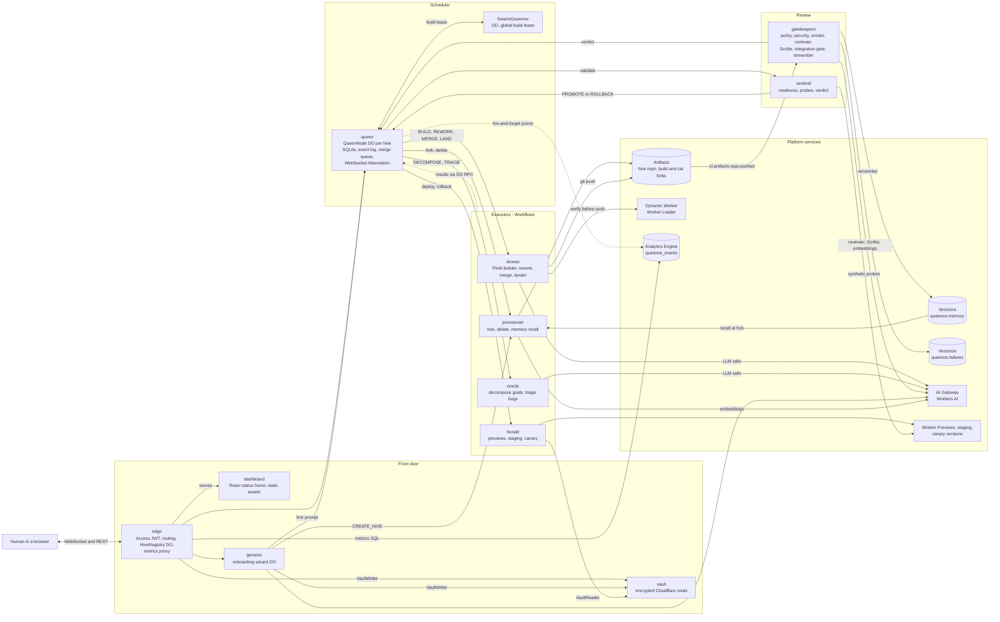

# QueenOS

**An army of virtual engineers, built on Cloudflare Artifacts. Not a GitHub clone.**

Built for Cloudflare's [next Git platform](https://blog.cloudflare.com/next-git-platform-on-cloudflare/) challenge. MIT licensed. Needs Node 22+ (`.nvmrc` pins 24; wrangler requires 22 or later).

QueenOS applies decades of software-engineering practice (tickets, design review, trunk-based development, merge queues, canaries, SLOs, runbooks, postmortems), adapted for agents that work in minutes and never get tired of re-running a pipeline. You state goals. The Queen, a Durable Object per hive, splits them into work items, hands the independent ones to many builder agents **at the same time**, reviews every change several ways, lands it through a speculative merge queue, ships it through canaries and files its own bugs when something breaks. A hive is **autonomous by default**: humans hear about it only when something escalates.

What makes it more than a pipeline:

- **Parallel builds.** Independent items fork from `main` at the same moment and build concurrently. Only dependent items wait.
- **A speculative, batched merge queue.** Passed builds board *cars*; a MERGE drone 3-way merges each car onto the speculative tip, the merged tree is re-gated, and a fast-forward push lands it. A failed batch is bisected; a conflict becomes an agent-driven rework, not a human merge session.
- **Best-of-N races.** Hard items and reworks are built by 2 to 3 agents on different models from the same base; the best passing candidate lands.
- **Self-filed bugs.** Builders and gates file follow-up bugs for what they notice outside the diff, and a rolled-back release files a P0. Hard caps and dedupe keep bugs from breeding bugs.
- **SLO-gated autonomy.** Releases ship themselves while the gates, Sentinel and the change-success error budget are green. An exhausted budget or a rollback streak drops the hive to `supervised`, where a human taps to ship.
- **Trace drill-down.** One trace id runs from item to build to merge-queue car to gate to release to Sentinel. The dashboard drills from the status home down to an item, a lane, a trace waterfall and the raw event log.

## Practices, adapted

Every row below is built and tested; design section numbers refer to [docs/v2-design.md](docs/v2-design.md).

| Practice (human origin) | What QueenOS does | Adapted for agents |
|---|---|---|
| Ticketing | The work ledger (§2.1): items with kind, priority, acceptance criteria, dependencies and a state machine. | Agents file tickets too (follow-ups, gate findings, rollbacks), behind caps and exact plus vector dedupe (§2.9). |
| Design review, tech-lead planning | The **Oracle** (§3.3) decomposes a goal into items, orders them by dependency, rates difficulty and predicts touched paths. | One structured LLM call. If it fails, the fallback is one item holding the whole prompt, so planning never blocks work. |
| Trunk-based development | Every build forks from current `main` and lives minutes (§2.3). | No branches to rebase by hand: the queue merges or an agent reworks. |
| Code ownership | **Path affinity** (§2.3.5): an active item temporarily owns the paths it is predicted to touch; overlapping items are serialised before they start. | Claimed automatically from the Oracle's prediction, widened by what the builder actually changed. |
| Merge queue with speculative batching (bors, Zuul) | Cars stack speculatively, batch from whatever has passed, are gated as a whole and land by fast-forward. A failed batch bisects (§2.3.4). | A conflict is a REWORK task for an agent. |
| CI gates and code review | Policy and security scans, a preview smoke test and an LLM reviewer against the acceptance criteria on every build; the integration gate on every merged car. | Review is parallel and per change, and it scores race candidates. |
| Prototype bake-offs | **Races** (§2.3.6). | Affordable because agents are cheap and the ranking is deterministic. |
| Canary releases, automatic rollback | Staging, then 1, 10, 50 and 100 percent with Sentinel probes at each step; a bad step rolls back. | Promotion is automatic in autonomous hives. |
| SLOs and error budgets | A change-success SLO over recent releases; an exhausted budget degrades the hive to `supervised` (§2.4, §2.8). | The budget gates autonomy, not only alerts. |
| Incident escalation with runbooks | Escalations with a fixed reason enum, a runbook and allowed actions (§2.5). | The Queen has already parked, degraded or stopped before a human is asked. |
| Postmortems, institutional memory | Every gate verdict is written to hive memory and recalled at the next fork; a rollback files a P0 bug carrying the verdict. | Recalled into the next builder's prompt automatically. |
| WIP limits (Kanban) | `maxActiveTrains` per hive, merge-queue depth and batch size, and a global ceiling leased from the **SwarmGovernor** (§2.9, §4). | Limits derive from real platform quotas, such as Workers AI requests per minute. |
| Distributed tracing | One trace id per goal across every executor (§2.6). | Kept in our own event log, because platform tracing does not span a Workflow's lifetime. |

## The three questions

### How do agents know what other agents are working on?

**One Queen per hive, one event log, shared memory.** *Primitives: Durable Objects + SQLite + WebSocket hibernation, Artifacts, Vectorize, Workers AI.*

- **The Queen is the single source of truth.** A SQLite-backed Durable Object per hive holds the work ledger, trains, merge-queue cars, path claims, releases and escalations. State changes are written first, then broadcast over hibernating WebSockets (coalesced into one frame per 100 ms). Agents never talk to each other: they read and write through the Queen, which only decides, records and dispatches; executors do all external I/O.
- **Event log and trace.** Every decision appends to one `event_log` in the same transaction as the state change, so the log is both the audit trail and the source of the dashboard drill-downs. One trace id links an item to its builds, cars, gates, release and Sentinel verdicts.
- **Hive memory.** Every gate verdict is embedded (`@cf/baai/bge-base-en-v1.5`) into Vectorize (`queenos-memory`). When the Provisioner forks a build it recalls up to 5 memories from the same hive (cosine score 0.6 or higher) and the builder receives them as `ragContext`. Drones are thrown away after each build; what they learned is not. The per-commit Cognitive Ledger (a git note in `refs/notes/queen`) keeps the agent's reasoning.

### What happens when they make conflicting changes?

**Avoid them first, then queue what remains.** *Primitives: Artifacts forks, Workflows, Durable Objects.*

- **Path affinity** serialises items that are predicted to touch the same paths before either starts.
- Anything that still overlaps meets the **speculative, batched merge queue**: passed builds board cars, the MERGE drone 3-way merges them onto the tip, and the **integration gate** re-validates the merged tree. A conflict sends the item back as a REWORK with the conflict as context. A failed batch **bisects** to find the member that broke it; the rest land. See the [walkthrough](#merge-queue-walkthrough).

### How do you review everything they produce?

**Layered gates, then SLO-gated shipping.** *Primitives: Event Subscriptions (`cf.artifacts.repo.pushed`), Workflows, Worker Preview URLs and gradual deployments, AI Gateway / Workers AI.*

1. **Gates.** Every push to a build fork fires `cf.artifacts.repo.pushed`, which starts the gatekeepers Workflow: a **Policy** scan (dependency allowlist, imports), a **Security** scan (secrets, `eval`, outbound hosts), then a **preview smoke test** against the build's Worker Preview URL, which must answer 2xx on `GET /`.
2. **LLM reviewer.** A Workers AI model through AI Gateway reads the prompt, the changed files and what the preview actually served, and judges intent. A rejection becomes the Scribe summary and a REWORK that carries the feedback. If the model is unusable the reviewer fails open.
3. **Scribe.** Compacts a failure log into at most 500 characters. The Queen never sees raw logs; that summary is what it stores, the dashboard shows and the rework builder receives.
4. **Integration gate.** Each merged car is gated again on the merged tree (policy, security, smoke; no reviewer) before `main` moves.
5. **Sentinel.** Landing is not shipping. The Queen cuts a release; the Herald deploys it to `<hive>-staging`; Sentinel runs a readiness gate, then synthetic probes pinned to each Worker version, and returns PROMOTE or ROLLBACK. Again at each canary step (1, 10, 50, 100 percent), with automatic rollback.
6. **Error budgets.** In an autonomous hive, a PROMOTE at staging ships on its own only while the change-success budget is green. Two rollbacks in a row, or an exhausted budget, degrade the hive to `supervised` and raise an escalation; a human then resolves it or taps to ship.

<!-- screenshots: War Room swarm, memories panel, release timeline -->

## Scale: dozens live, thousands by design

The honest numbers (platform limits checked 2026-10-05, [design §4](docs/v2-design.md)):

- **Demonstrated:** dozens. In sim, 24 builds run at once in one hive with the lease ceiling at 1,000 and `maxActiveTrains` at 64. Live on `demo` the plan is 12 to 24 concurrent builders (a 60-build lease at 240 requests per minute).
- **The real ceiling is Workers AI rate limits.** Text generation is 300 requests per minute per account by default. A build costs about 4 requests per minute of AI, so one account supports roughly 75 concurrent builders. We have not asked for a limit raise; 1,000 concurrent builders would need about 4,000 requests per minute.
- **Second ceiling: Artifacts control plane** (2,000 requests per 10 s per namespace, shared by all hives), about 25 build starts per second.
- **Not a bottleneck:** Workflows (50,000 concurrent instances), Vectorize, Analytics Engine writes (capped at 200 points per invocation).
- **What is built for scale:** the Queen's warm in-memory state cache (no SQLite reload per RPC), coalesced WebSocket broadcast, batched executor dispatch (`createBatch`, up to 100 per call), per-hive WIP limits, the global `SwarmGovernor` lease, and 429-aware AI retries that do not count against the model router.
- **What is designed, not built:** one `TrainNode` Durable Object per build, a sharded event log, a `RoomNode` for viewers, sub-queens per repo area and a hive of hives (design §4.5). They need no contract changes.

## Architecture

Eleven components (ten Workers plus the dashboard, which the edge serves as static assets), one Queen Durable Object per hive. Every executor reports its result back to the Queen over Durable Object RPC, keyed by command id, so retries and late results are ignored rather than corrupting state.



| Worker | Role |
|---|---|
| `queen` | Scheduler and state: the `decide()` pipeline (work, train, merge-queue, release and escalation planners), model router, autonomy and error budget, event log, watchdogs, coalesced WebSocket room. Also hosts the `SwarmGovernor` DO. Reachable only through the edge. |
| `queenos-edge` | Front door at `queenos.kaikeru.com`: Access JWT verification, dashboard assets, routing, project registry, allowlisted metrics proxy. |
| dashboard | React + Vite: status-first home, swarm floor, merge-queue page, item page, lanes, trace waterfall, event log, metrics. Served by the edge. |
| `queenos-oracle` | DECOMPOSE a goal into items (dependencies, difficulty, predicted paths) and TRIAGE bugs (dedupe). |
| `queenos-provisioner` | Artifacts fork and delete, seeds new hives from `templates/worker-starter`, recalls hive memories on fork. |
| `queenos-drones` | BUILD, REWORK, MERGE and LAND. The builder is a Think agent (below). |
| `queenos-gatekeepers` | Policy, security, preview smoke, LLM reviewer, Scribe, integration gate, failure log and hive memory writes. |
| `queenos-herald` | Worker Preview per build, `<hive>-staging`, canary splits on `<hive>-app`, rollback. |
| `queenos-sentinel` | Readiness gate, synthetic probes per version, PROMOTE or ROLLBACK. |
| `queenos-vault` | Per-hive AES-GCM envelope-encrypted Cloudflare credentials. |
| `queenos-genesis` | Onboarding wizard: chat, charter, connect Cloudflare, create hive, first flight. |

## The drone builder

The builder is a [`@cloudflare/think`](https://www.npmjs.com/package/@cloudflare/think) tool-loop agent (`apps/drones/src/agent/`), one Durable Object per build attempt and model. Inside the drone Workflow it works on a workspace seeded from the train's fork with Think's file tools (read, write, edit, list, find, grep, delete), capped at 16 steps. Before it can finish, it must call `verify`: the edited Worker is loaded into a **Dynamic Worker** through the Worker Loader binding, with outbound network blocked, and `GET /`, `/health` and any extra paths are fetched so the agent sees real status codes and bodies. `finish` is refused unless the last `verify` came after the last edit and passed. Only then does the Workflow push to Artifacts, with the tool trace recorded in the commit's ledger note. The Dynamic Worker check proves the routes answer; the Herald preview, the gatekeepers and Sentinel remain the deploy truth. The Queen picks the model per task (the model router) and every call goes through AI Gateway; `DRONE_HARNESS=single-shot` keeps the older single-call JSON builder.


## Merge queue walkthrough

An item **P** passes its build; **Q** and **R** do too, and **R** edits a file Q also changed without the Oracle predicting it. Meanwhile **S** passes alone but breaks the app once merged with others.

1. All four items built in parallel, each forked from the same `main`. Each one's gates passed on its own.
2. Passed builds board a **car**: `[P, Q, R, S]`, forked from the speculative tip (a car may stack on the previous car before it lands).
3. The MERGE drone 3-way merges the members onto the tip. R conflicts with Q: R is dropped from the car, ejected as a merge conflict and requeued as a **REWORK** that waits for the car, then rebuilds on top of Q's landed change.
4. The **integration gate** runs on the merged tree of `[P, Q, S]` and fails (S broke `/` when merged).
5. The car is **bisected**: halves rebuild as smaller cars (`[P, Q]`, then `[S]`), each re-gated. P and Q land; S fails alone-vs-integrated and goes back as a rework with the reason as context.
6. Landing is a fast-forward push to `main` (Artifacts has no merge API), by the LANDER drone. Each landed car feeds the release planner, which cuts a release: staging, Sentinel, then (in an autonomous hive with a green budget) canary to 100 percent.

Results arrive in any order and webhooks retry: duplicate or late results return `ignored:*` instead of corrupting state. The planners are pure (`apps/queen/src/train/`, `src/work/`, `src/release/`) and unit-tested; see [apps/queen/README.md](apps/queen/README.md) for the decision pipeline and route tables, and design §2.3.4 and §3.2a/b for the detailed flows. In a live hive the exact bisect path depends on timing; the deterministic case is covered by an end-to-end test.

## Cloudflare primitives

| Primitive | Why |
|---|---|
| **Artifacts** | Git repos as an API. `fork()` gives every build and merge-queue car its own cheap copy, all from `main` or the speculative tip; repos are deleted when they end. |
| **Workers** | Hono HTTP surface for the edge and the Queen, and one Worker per executor (Oracle included). Service bindings between them; no Node built-ins anywhere. |
| **Durable Objects + SQLite + WebSocket hibernation** | One Queen per hive, plus the global `SwarmGovernor` lease: serialized scheduling (no races between webhooks), durable state, cheap live fan-out to dashboards. Alarms retry failed fork/dispatch intents. |
| **Workflows** | Oracle, provisioner, drones, gatekeepers, Herald and Sentinel are durable, retryable, multi-step jobs. A crashed step resumes instead of restarting. |
| **Event Subscriptions** | `cf.artifacts.repo.pushed` triggers the gatekeepers Workflow; no polling. |
| **Vectorize** | `queenos-memory`: hive memory, one entry per gate verdict, recalled at fork. `queenos-failures`: failure logs. |
| **AI Gateway / Workers AI** | Every LLM call (builder, reviewer, Scribe, Genesis) goes through the Workers `AI` binding and the `queenos` gateway for logging, caching and rate limits; models are Workers AI `@cf/...` models. Embeddings use `@cf/baai/bge-base-en-v1.5`. |
| **Worker Preview URLs and gradual deployments** | Each build gets a Preview URL for the smoke test and reviewer; releases move traffic between Worker versions at 1, 10, 50 and 100 percent. |
| **Dynamic Workers (Worker Loader)** | The builder runs its own edited Worker, with no network, to verify it before pushing. |
| **`@cloudflare/think`** | The builder's agent loop and workspace tools, one Durable Object per build. |


## Quickstart (local, no credentials)

Sim mode runs the real Queen Worker and Durable Object, the real planners and the real dashboard, with fake Artifacts, Oracle, provisioner, Herald, Sentinel and drones that advance on their own. The whole pipeline plays out on your laptop.

Prerequisites: Node 22+ (`.nvmrc` pins 24), pnpm 10.15 via `corepack enable` (it reads `packageManager`), and ports 8787 (Queen) and 5173 (dashboard) free.

```bash
nvm use                                    # Node 24 (22+ works)
corepack enable                            # pnpm 10.15 from package.json
pnpm install
pnpm dev:sim                               # Queen on :8787 and dashboard on :5173, together
```

Open <http://localhost:5173/p/demo>, the Status home for the `demo` hive (`/?hive=demo` also works). The dashboard proxies `/hives` to the Queen at `localhost:8787` (override with `QUEEN_DEV_URL`). To run them separately: `pnpm --filter @queenos/queen dev:sim` and `pnpm --filter @queenos/dashboard dev`.

Click **Swarm demo (24)** in the composer. It files one goal that the sim Oracle splits into 24 items. You should see:

- **24 builds at once** on the swarm floor, finishing out of order (sim builds take 4 to 12 seconds, jittered).
- **One race:** a `[race]` item built by 3 models, with the best passing candidate winning.
- **Cars in the merge queue** (the Queue page, `/p/demo/queue`): passed builds board cars, two items collide on a shared file and one is reworked, and one car fails its integration gate and bisects.
- **Everything SHIPPED with no human:** new hives are autonomous, so staging auto-promotes and the canary runs 1, 10, 50 and 100 percent. Click into any item, then its trace, to see the waterfall.

### Prompt markers

The sim reads markers in prompt text to script outcomes. Combine them freely.

| Marker | Effect in sim |
|---|---|
| `[fail]` | The first build fails the security scan; the rework (escalated to a frontier model) passes. |
| `[review-fail]` | Passes the scans, but the LLM reviewer rejects the first build; the rework is approved. |
| `[bad-json]` | The chosen model returns unusable output, so the first fallback model builds instead. |
| `[race]` | Best-of-3 race for that item. |
| `[hard]` | Marks a decomposed item as hard (raced at width 3). Works in goals sent with `decompose`. |
| `[touch:path]` | Predicts (and changes) `path`, so path affinity serialises items that share it. Repeatable. |
| `[collide]` | The build also changes `src/lib/shared.js` without predicting it: two such items conflict in the merge queue and one is reworked. |
| `[batch-fail]` | Passes alone, fails the integration gate when merged with others: watch the car bisect. |
| `[spot-bug]` | The builder files a follow-up bug ("Spotted: README badge link 404s"). |
| `[gate-spot]` | The gate files a follow-up bug for a finding outside the diff. |
| `[canary-fail]` | The release containing it rolls back at the 10 percent canary step. Two rollbacks in a row degrade the hive to `supervised`. |
| `[inconclusive]` | Sentinel returns an inconclusive verdict at staging and ROLLBACK. |
| `[decompose-fail]` | The Oracle fails, so the goal falls back to one item holding the whole prompt. |

With `decompose`, the sim Oracle splits one item per bullet line (or per `;`), and `(after N)` or `depends on #N` makes an item wait for item N.

### Try it with curl

```bash
# a goal the Oracle splits into items: one races, two touch the same path, one is hard
curl -X POST localhost:8787/hives/demo/prompts \
  -H 'content-type: application/json' \
  -d '{"namespace":"demo","decompose":true,"promptText":"- Add a /features/otter endpoint [race]\n- Add a /features/falcon endpoint [touch:src/lib/shared.js]\n- Add a /features/maple endpoint [touch:src/lib/shared.js]\n- Add a /features/comet endpoint [hard]"}'

curl localhost:8787/hives/demo/queue          # active cars, passed builds waiting to board, recent conflicts and bisects
curl localhost:8787/hives/demo/items/<id>     # one item: children, builds, cars, races, release, escalations (ids come from the POST response and /snapshot)
curl localhost:8787/hives/demo/snapshot       # the whole hive as JSON
```

`POST /prompts` returns `201` with the new `item` (and a `promptRun`). Without `decompose` it files one feature item.

**Supervised mode and tap-to-ship.** To see the human path instead, make the hive supervised; staging then stops at AWAITING TAP and you tap in the dashboard or by hand:

```bash
curl -X PATCH localhost:8787/hives/demo/settings -H 'content-type: application/json' -d '{"autonomy":"supervised"}'
curl -X POST localhost:8787/hives/demo/releases/<releaseId>/tap -H 'x-queen-user: you@example.com'
```

The older **Launch demo swarm** (4 prompts: `[fail]`, `[review-fail]` and two clean ones) is on the lanes page, `/p/demo/lanes`.

## Tests

```bash
pnpm test                                  # everything, via Turborepo
pnpm turbo run build typecheck lint test   # the full gate
```

Some "uncaught exception ..." and "Worker's code had hung" lines in the output come from deliberate negative-path tests; the summary line is the verdict.

| Package | Covers |
|---|---|
| `apps/queen` (workerd via `@cloudflare/vitest-pool-workers`) | Pure planner state machine; the Durable Object end to end with fake Artifacts and drones (fork chaining, ejection, rework, landing, reconcile alarms); WebSocket protocol and hibernation; bearer-token auth on machine routes; sim ports. |
| `apps/drones` (workerd) | Drone workflow orchestration with fake ports and scripted LLM output; the builder agent's tools and Dynamic Worker verify with a fake loader. |
| `apps/gatekeepers` | Policy, Security and test gatekeepers, preview smoke, reviewer, Scribe compaction, Vectorize failure and hive memory. Triggered by `cf.artifacts.repo.pushed` via `triggers.events`. |
| `apps/dashboard` (vitest, node) | The dashboard reducer and data layer: snapshots, items, lanes, queue, trace and metrics views. |
| `packages/hive-kit`, `packages/queen-types` | Git on isomorphic-git + in-memory fs, ledger payloads, AI Gateway client, Zod schemas. |

## Full stack locally (optional, not needed for the demo)

The Quickstart above is all the demo needs. This section is optional. It uses port 8787 for the edge, so stop the sim (`pnpm dev:sim`) first. It runs the edge (dev auth), Genesis (scripted LLM, fake provisioner), the Vault (against a local fake Cloudflare API) and the Queen (sim) together.

One-time setup (both files are gitignored):
- `apps/vault/.dev.vars`: `VAULT_KEK=<openssl rand -base64 32>` and `VAULT_DEV_CF_BASE=http://127.0.0.1:8799`
- `apps/genesis/.dev.vars`: `GENESIS_DEV_FAKE_PROVISIONER=1`

```bash
pnpm --filter @queenos/dashboard build
node scripts/dev/fake-cloudflare.mjs &
(cd apps/vault   && pnpm exec wrangler dev --port 8791 --inspector-port 9291) &
(cd apps/queen   && pnpm exec wrangler dev --env sim --port 8792 --inspector-port 9292) &
sleep 12
(cd apps/genesis && pnpm exec wrangler dev --port 8793 --inspector-port 9293) &
(cd apps/edge    && pnpm exec wrangler dev --env dev --port 8787 --inspector-port 9294) &
```

Open http://localhost:8787. Any 32-hex account id and any fake token work. The edge's `dev` env and the Queen's `sim` env refuse non-localhost requests, so deploying them by mistake can't bypass Access.

## Deploy to Cloudflare

Needs a Workers Paid account (Artifacts) and wrangler 4.145+. Steps marked **(unverified)** have not been run against a real account; [docs/day1-verification.md](docs/day1-verification.md) is the runbook for resolving them.

The public front door is one Worker, `queenos-edge`, at **https://queenos.kaikeru.com**, behind Cloudflare Access. It verifies the Access JWT, serves the dashboard, hosts the project registry, and forwards to `queenos-vault`, `queenos-genesis` and the `queen` over service bindings. The queen has `workers_dev: false`, so it is reachable only through the edge.

### One-time resources

- Vectorize indexes (768 dims, cosine, matching the 768-dim `@cf/baai/bge-base-en-v1.5` embeddings): `wrangler vectorize create queenos-failures --dimensions=768 --metric=cosine` for failure logs, and `wrangler vectorize create queenos-memory --dimensions=768 --metric=cosine` plus `wrangler vectorize create-metadata-index queenos-memory --property-name=namespace --type=string` for hive memory (the gatekeepers write it, the provisioner reads it; recall filters on `namespace`).
- AI Gateway named `queenos` (authenticated). LLM calls use the Workers `AI` binding through the gateway, so there are no tokens or provider keys. The Queen's model router picks the builder model per task from `MODEL_CATALOG` (all Workers AI `@cf/...` models); `MODEL_BUILDER` is only the fallback. The Scribe and reviewer models are wrangler vars `MODEL_SCRIBE` and `MODEL_REVIEWER`. `DRONE_LLM_MODE` is `live` or `scripted` (deterministic); `DRONE_HARNESS` is `agent` (the Think builder) or `single-shot`; `REVIEW_MODE` is `llm`, `scripted` or `off`.
- Worker Loader binding for the drones (`worker_loaders`, binding `LOADER`) so the builder can verify in a Dynamic Worker.
- Event subscription: `cf.artifacts.repo.pushed` to the gatekeepers Workflow via `triggers.events`, filtered by namespace only (repo-name globs are accepted but never match, so the Workflow filters `<hive>-train-*` itself; see [docs/day1-results.md](docs/day1-results.md)).

### Deploy

```bash
scripts/deploy.sh              # bootstrap pass if needed, then full pass
scripts/deploy.sh --bootstrap  # force the bootstrap pass
scripts/deploy.sh --dry-run    # build every bundle into .deploy-dryrun/, deploy nothing
```

The Workers bind to each other in cycles (queen and the executors, genesis and the provisioner, the edge to everything), and wrangler rejects a binding to a script that does not exist yet (code 10061, `docs/day1-results.md`). The script therefore runs two passes over queen, oracle, provisioner, herald, sentinel, drones, gatekeepers, vault, genesis and edge:

1. **Bootstrap pass** (automatic when any script has never been deployed, or forced with `--bootstrap`): deploy every Worker from a temporary config with its cross-script bindings stripped (DO and Workflow bindings that have `script_name`, and all `services`). Own DOs, Workflows, migrations, assets and routes are kept. The real config files are untouched.
2. **Full pass:** deploy every Worker with its full config.

The provisioner's template generator runs before it deploys, and the dashboard is built before the edge. It deploys with `--env=""` (the `sim`, `dev` and `test` envs are not for deployment) and prints the manual steps below when it finishes. `--only <app>` limits a pass to one app dir (e.g. `--only edge`).

### One-time setup (after the first deploy)

Your Zero Trust team is `kaikeru` (team domain `kaikeru.cloudflareaccess.com`).

1. **Access application.** Zero Trust > Access > Applications > Add > Self-hosted. Domain `queenos.kaikeru.com`, all paths. Add a policy: Action Allow, Include emails ending in `@kaikeru.com`. The edge repeats the domain check on the verified JWT as a second layer.
2. **AUD.** Copy the application's "Application Audience (AUD) Tag" into `ACCESS_AUD` in `apps/edge/wrangler.jsonc` and redeploy the edge (`pnpm --filter @queenos/edge deploy`). While `ACCESS_AUD` is empty the edge fails closed: every route except `/health` returns 503.
3. **Vault key.** Generate and store the key-encryption key on the vault Worker:
   ```bash
   openssl rand -base64 32 | pnpm --filter @queenos/vault exec wrangler secret put VAULT_KEK --env=""
   ```
4. **Queen machine token.** `openssl rand -hex 32 | pnpm --filter @queenos/queen exec wrangler secret put QUEEN_INTERNAL_TOKEN --env=""`. It guards the Queen's machine-only HTTP routes, which return 503 without it.
5. Open https://queenos.kaikeru.com, sign in, and confirm the dashboard connects.

Local development: `pnpm --filter @queenos/edge exec wrangler dev --env dev` skips Access verification and acts as `DEV_USER_EMAIL`. Never deploy the `dev` env.

## Repo layout

```
apps/queen         Hono Worker + QueenNode DO (scheduler, state, merge queue, event log) and SwarmGovernor DO
apps/edge          Front door: Access JWT, routing, project registry, serves the dashboard
apps/genesis       Onboarding wizard DO
apps/vault         Per-hive encrypted Cloudflare credentials
apps/oracle        Workflow: decompose goals into items, triage bugs
apps/provisioner   Workflow: Artifacts fork / delete, hive seeding, memory recall
apps/drones        Workflow: Think builder (Dynamic Worker verify), rework, merge and lander drones
apps/gatekeepers   Worker + Workflow: Policy / Security / smoke, LLM reviewer, Scribe, Vectorize memory
apps/herald        Workflow: Worker Previews, staging, canary, rollback
apps/sentinel      Workflow: readiness gate, synthetic probes, PROMOTE / ROLLBACK
apps/dashboard     React + Vite: status home, queue, item, trace, events, metrics
templates/         worker-starter, the seed for new hives
packages/queen-types   Shared Zod schemas and types
packages/hive-kit      Worker-safe git, AI Gateway client, Cognitive Ledger helpers
docs/discovery.md      Platform research: what is verified vs unverified
```

## Design decisions

- **One Queen per hive, as a Durable Object.** Single-threaded scheduling removes webhook races; every other component is stateless or ephemeral. See [docs/discovery.md](docs/discovery.md) §4.
- **Parallel builds from `main`, speculative cars for landing.** Independent items build at once; a car stacks its merged members on the speculative tip, so a car that passes is what will land.
- **Landing is a push.** Artifacts has no merge API, so a lander drone pushes the passed head to `main`.
- **Persisted intents.** Fork, delete and dispatch are written to SQLite before any I/O and re-issued by an alarm if they fail.
- **Pure planner.** Planner logic (work, train, queue, release) has no I/O, clock or randomness, so it is tested exhaustively and deterministically.
- **Platform unknowns are documented, not assumed.** [docs/discovery.md](docs/discovery.md) cites a source or says UNVERIFIED.

## Known limitations

- **The test verdict is scripted.** The gate does hit a real preview (smoke test plus reviewer evidence), but `GATE_TEST_MODE=scripted` fails on a `[fail]` marker instead of running a test suite; a sandboxed test runner is not implemented. Builds are not compiled: the starter template is plain JavaScript modules.
- **The reviewer fails open.** If its model is unavailable the gate continues, so an outage does not eject trains. It is an LLM, so it can approve a change that misses the prompt.
- **Sentinel uses synthetic probes only.** With little traffic on a demo app that is the real signal. If staging fails there is no automatic bisect or revert; the Queen files a P0 bug instead.
- **Scale is a design target.** Dozens of concurrent builders are demonstrated; thousands would need a Workers AI limit raise (not requested) and the sharding in design §4.5, which is not built.
- **Live bisect is timing-dependent.** The deterministic bisect case is covered by an end-to-end test and the sim; a live batch failure may resolve through reworks instead. There is no reliable live reviewer rejection to demo; the sim has one.
- **Hives created before v2 stay `supervised`** until switched (`PATCH /hives/<hive>/settings` or the dashboard's autonomy dropdown). New hives are autonomous.
- **Git notes are read via git, not the Artifacts binding.** The `refs/notes/queen` push is accepted ([docs/day1-results.md](docs/day1-results.md)); the `.queen/ledger/<sha>.json` fallback remains as a safety net.
- **TypeScript policy scanning is heuristic** (AST pattern checks), not a full static analyzer.
- **Auth is at the edge.** Machine routes on the Queen need a bearer token, and the Queen is reachable only through the edge, which verifies the Cloudflare Access JWT. Inside the Queen, `POST /prompts`, `GET /snapshot` and the WebSocket room are not authenticated per user or per hive; there are no per-hive permissions.
- **Artifacts billing starts 2026-10-14**; fork cost and latency are unmeasured.
- **Sim mode is a simulation.** It exercises the Queen and dashboard for real, but drones and Artifacts are fakes.

## License

[MIT](LICENSE) © 2026 Kyle Wagner
